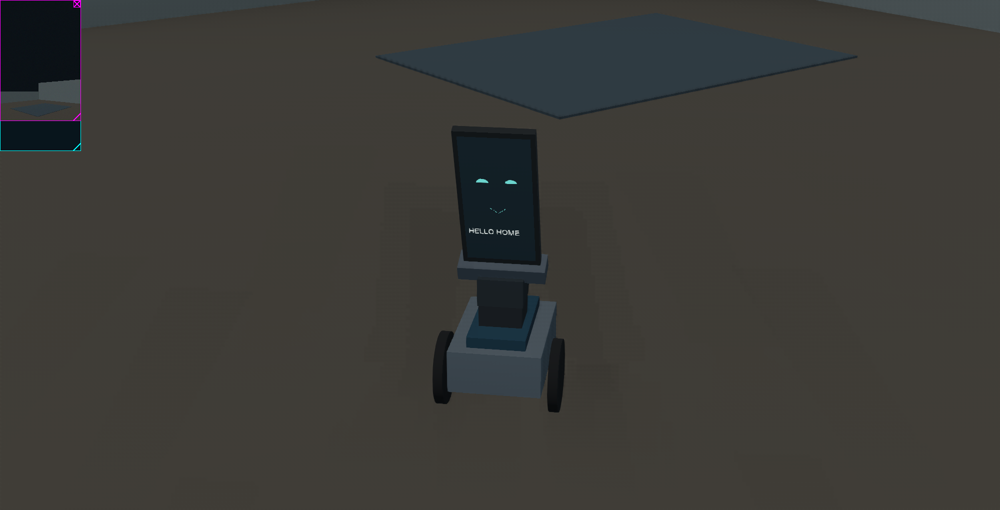

# Home Bot

A home inspection robot with a **Google Pixel 5 as its brain and sensors**, an
**Arduino Mega** for actuator control, and a **Boe-Bot chassis**. Develop the robot
in Webots before assembling and calibrating the physical system.

The portrait-mounted phone looks forward through its rear camera. A two-axis
mount lets it look around and turn to present facial expressions and text on its
screen. A future arm/gripper will extend the platform to household tasks.



## What works today

- Original Apache-2.0 Webots robot model: two driven wheels with position
  feedback, passive caster, pan/tilt with feedback, portrait Pixel envelope,
  rear camera, phone-frame accelerometer and gyro, and screen expressions/text.
- A furnished test room with a doorway, rug, furniture proxies, and visual target.
- Local operator panel: hold-to-drive controls, camera stream, pan/tilt sliders,
  four expressions, screen text, feedback telemetry, and wheel odometry.
- A versioned JSON command API, speed limits, and a motion watchdog that expires
  on either simulation time or real time.
- Unit/API tests and an actual Webots maneuver test with images and a JSON report.

**This is a simulator prototype.** Autonomous navigation, the native Android app,
Pixel-to-Mega transport, servo feedback decoding, and physical firmware are not
implemented yet. No commands are sent to hardware.

## Run the prototype

Install the free [Webots R2025a release](https://github.com/cyberbotics/webots/releases/tag/R2025a)
and Python 3.11 or later. No paid services, Unity, Unreal, ROS, or Python runtime
packages are required. Webots itself is installed separately from this repository.

```sh
git clone https://github.com/pH34r-pH/home-bot.git
cd home-bot
python scripts/build_worlds.py
```

On Windows:

```powershell
.\scripts\run_webots.ps1
# Or specify your installation:
.\scripts\run_webots.ps1 -Webots 'C:\Program Files\Webots\msys64\mingw64\bin\webots.exe'
```

On Linux/macOS, launch Webots from its installation with this world:

```sh
webots --mode=realtime sim/webots/worlds/inspection_room.wbt
```

Alternatively, open `sim/webots/worlds/inspection_room.wbt` in Webots and press
Play in **real-time** mode. Open **http://127.0.0.1:8765** in a browser.
The 3D view also supports **W/S** drive, **A/D** turn, **X** stop, **F** show face,
**C** camera forward, and **H** happy; focus the 3D view for keyboard controls.

Release a drive button to stop. Commands expire after 400 ms by default. In fast
simulation mode the simulated watchdog can expire between browser commands;
use real-time mode for interactive control. On expiry, wheel commands stop and
the gimbal holds its last target; the physical system will need its own watchdog.

The server binds to loopback. The phone-to-simulation network bridge is a future
milestone, so a physical phone cannot yet control this panel from another device.

### Tests

```sh
python -m unittest discover -s tests -v
python scripts/build_worlds.py --check
python scripts/run_smoke.py --webots /path/to/webots
```

For Windows, pass the full `webots.exe` path to `--webots`.
The smoke test runs a separate world, checks driving, turning, gimbal feedback,
forward camera orientation, phone IMU axes, screen state, watchdog stop, and base
stability. Evidence goes into the ignored `artifacts/` folder. It closes its own
Webots instance on completion. Core tests run in GitHub Actions; simulation testing
is local because it needs the Webots runtime and an OpenGL-capable environment.

If Webots cannot find Python, choose your Python executable under
**Tools → Preferences → General → Python command**. If port 8765 is occupied,
close the other prototype instance or change `http_port` in `config/robot.json`.

## Hardware assumptions

Owner-confirmed: Arduino Mega, Boe-Bot chassis, matched continuous-rotation wheel
servos with position feedback, two similarly sized feedback actuators for pan and
tilt, and an upright Pixel 5. Approximate top speed is 1 mph; it is not measured.

The actuator models, electrical feedback signals, mechanical travel, wheel
dimensions, torque, gimbal geometry, and mass distribution still need confirmation.
The simulation's **0–180° pan travel is a design target**, not a verified capability
of the existing mount. “Stepper-servo” is recorded as the owner's description;
the electrical interface is not assumed. No pinout or pulse calibration is guessed.

Edit `config/robot.json` for controller limits and camera settings, then run
`python scripts/build_worlds.py` and reload the world. The generator passes these
parameters to the model, keeping motor limits and controller calculations aligned.
Approximate chassis/cradle geometry and mass live in `HomeBot.proto`.

## Project map

| Path | Purpose |
| --- | --- |
| `sim/webots/protos/HomeBot.proto` | Original robot geometry and joints |
| `sim/webots/worlds/inspection_room.wbt` | Interactive test environment |
| `src/home_bot/` | Control core, Webots adapter, API and panel |
| `config/robot.json` | Provisional robot parameters |
| `tests/` | Protocol, watchdog, odometry, image and API checks |
| `docs/hardware.md` | Confirmed parts, assumptions, calibration checklist |
| `docs/architecture.md` | Pixel/Mega design and coordinate frames |
| `docs/protocol.md` | Simulation API contract |
| `docs/roadmap.md` | Milestones through the eventual arm |

## License

Original code, geometry, documentation, and generated assets in this repository
are licensed under [Apache License 2.0](LICENSE). The bundled Webots Boe-Bot asset
was **not** copied: it has a separate Webots-only asset license. Webots and other
external tools retain their respective licenses. See [NOTICE](NOTICE).
