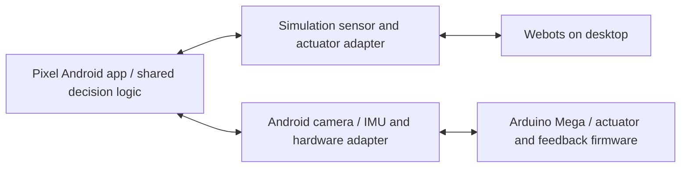

# Architecture

## Target system

The Pixel owns perception, pose estimation, navigation, behavior, face rendering
and remote inspection. The Mega owns actuator timing, wheel/gimbal feedback
acquisition and a command watchdog. Android is not used to generate servo pulses.

Today, a Python Webots controller and a loopback browser panel exercise the
command/observation contract. The Android app and hardware adapters are future
work. The control contract is reusable across platforms; Python code is not
presented as a library that automatically runs in native Kotlin.

The future Android app should separate `SensorSource`, `ActuatorSink`, behavior,
and presentation. Its test mode will consume observations from a desktop bridge;
its hardware mode will consume actual Android sensors and communicate with the
Mega over a verified USB or wireless link. USB host/charging behavior and the
Mega's particular USB interface must be checked before selecting a transport.
LAN authentication/pairing is not implemented by the current loopback server.

## Coordinate frames

World and chassis use +X forward, +Y left, +Z up. Positive angular velocity turns
left. Both wheel angles increase for forward rolling. Wheel odometry is a planar
estimate initialized at (0,0,0), not the robot's absolute world coordinates.

At zero pan/tilt the phone is upright with the rear camera toward chassis +X.
Pan is around +Z, positive left; tilt is around the pan stage's -Y, positive up.
The 0..π pan interval deliberately includes the proposed screen-forward pose.

Android device coordinates in portrait are +X toward the screen's right edge,
+Y toward its top edge, +Z out of the screen. At the zero pose these map to
chassis -Y, +Z, -X respectively. The simulated gyro and accelerometer are rotated
to use those Android axes. At rest upright, acceleration includes approximately
+9.81 m/s² on device Y, following Webots accelerometer proper-acceleration output.
Android's linear-acceleration sensor, which removes gravity, is a different signal.

Webots Camera uses +X optical-forward and +Z image-up. Its image is upright and
portrait; intrinsics and lens behavior are provisional. Camera and IMU both move
with the phone, so gimbal feedback is required to relate their motion to the base.
Future pose estimation must compensate the entire chassis→pan→tilt→phone transform,
including sensor offsets and gimbal measurement uncertainty.

No GPS, perfect world pose, synthetic depth or built-in object recognition enters
runtime observations. Smoke and pilot evaluators use Supervisor ground truth
to judge movement and stability. The interactive/pilot robot controller has
`supervisor FALSE`; `pilot.wbt` adds a separate evaluation-only Supervisor.

## Android and ARCore boundary

Pixel 5 supports ARCore and the Depth API, but Webots does not emulate the actual
ARCore tracker. A simulation adapter can provide images, IMU samples, and later
explicitly modeled pose/depth estimates. Actual ARCore tracking, depth failures,
camera lifecycle, thermal behavior and startup must be tested on the Pixel.

Use native Android APIs for camera/sensors and screen rendering; neither Unity
nor Unreal is needed on the phone. Start with driving while looking forward and
scanning while stationary. Concurrent navigation and gimbal movement comes after
frame transforms and tracking behavior are validated.

## Command ownership and stopping

The prototype has one effective command owner: the most recent valid panel/API
or keyboard command. HTTP threads only validate/queue data; Webots APIs run on
the simulation thread. Invalid input never refreshes the command watchdog.
Commands are complete snapshots, and omitted motion values are zero.

The motion watchdog uses both monotonic real time and simulation time. Expiry
sets wheel targets to zero while retaining gimbal pose and screen state. Motor
acceleration means a zero target is not an instantaneous physical stop. The
future Mega firmware needs an independent watchdog, feedback fault handling and
explicit arm/stop behavior. No hardware is driven by this prototype.
