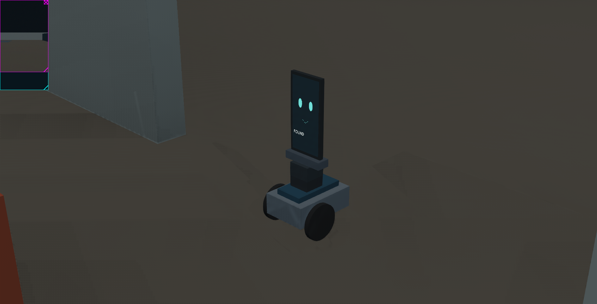
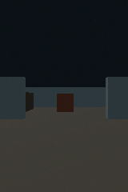
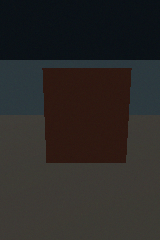
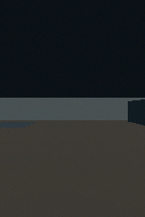

# Luna pilot 01 — partial success

On October 20, 2026 (Pacific time), a fresh **gpt-6-luna** subagent piloted Home
Bot in Webots using the [operator manual](../../pilot-manual.md), shell access,
and onboard camera images. It received no world map, target coordinates,
Supervisor interface, object detector or navigation policy. The parent did not
steer or correct its commands during the attempt. The model was explicitly
requested by the project owner; no model API dependency was added to the robot.

The model found the visible target, approached, stopped, turned the phone, and
displayed `FOUND`. **The complete task failed its distance criterion:** the robot
stopped 0.6157 m from the target center, outside the predefined 0.25–0.50 m band.
This was one attempt with no retry and no adjustment of the scoring criteria.

## Task and result

Task: find the orange upright rectangular object, approach without contacting
objects, stop facing it, then turn the phone screen toward it and display `FOUND`.
The [protocol](../../experiment-protocol.md) fixes the full scoring criteria.

| Measurement | Observed |
| --- | --- |
| Pilot session duration, first to last observation | 176.64 wall seconds |
| Commands | 12 drives, 2 head movements, 1 screen update, 1 stop |
| Saved camera observations | 18 |
| Wheel odometry displacement | 1.6844 m forward; negligible lateral/yaw change |
| Actual final center-to-target distance | **0.6157 m — failed** |
| Base heading toward target | Passed; negligible heading error |
| Screen orientation and text | Passed; pan 3.14159 rad, tilt approximately zero, `FOUND` |
| Stopped and upright | Passed |
| Above-floor contact events | Zero recorded |
| Full task success | **False** |

The separate evaluator sampled position, orientation and task criteria roughly
every 0.25 simulation seconds and checked contact points each 16 ms physics step.
Its output was unavailable to the pilot by instruction. Shared filesystem access
was not an OS sandbox. The contact criterion is a proxy for this flat room, not
a complete collision-safety test.

## What the pilot did

The target was visible and centered in the initial view. Luna tilted the camera
down by 0.2 rad and advanced straight in bounded segments, checking images and
feedback. Its drive speeds decreased from 0.04 to 0.03 to 0.025 m/s. Each segment
ended stopped; the local CLI handled heartbeat refresh and timing. Luna did not
command a base turn. After its last approach image, it rotated the head to pi,
leveled the phone, set `FOUND`, issued stop, and captured a final observation.

| Initial onboard image | Last onboard image before turning the phone | Final rear-camera image, now looking backward |
| --- | --- | --- |
|  |  |  |

Luna's final report estimated a distance of about 0.6 m and explicitly noted that
this might be beyond the requested band. The evaluator's 0.6157 m measurement
agrees with that estimate. The pilot expressed high confidence that it had found
the object and displayed `FOUND` toward it, but only moderate confidence about
the requested distance. The actual spectator image independently confirms the
screen text. See the [pilot report](pilot-report.md).

## What this supports

A general-purpose agent can use a small documented command interface to perform
an observe–decide–act loop, inspect actual camera images, control the base/head,
and coordinate a screen action. No robot-specific LLM framework or MCP server
was necessary for this first loop. The same transport can later sit behind MCP
or another model client without embedding a navigation policy in the tool.

This attempt also shows a useful failure: the model recognized its approximate
range but stopped before satisfying the requested metric band. No depth sensor
or known target dimensions were supplied. A next experiment could compare the
same task with a physically plausible range estimate or known-size marker, and
an explicit requirement to check each completion condition before declaring done.
Any simulator-only ground-truth range would need separate labeling and would not
establish physical transfer.

The target began in view, the path was straight through a wide doorway, and the
scene was synthetic with ideal joint feedback. There was no search around
occluded obstacles, route choice, recovery from collision, native Android app,
real servo calibration or unattended home operation. One attempt cannot establish
a success rate or compare models.

## Evidence

- [Machine-readable summary](summary.json) and [final evaluator report](evaluation.json).
- [Complete CLI event trace](pilot.jsonl), with portable relative paths.
- [Ground-truth trajectory](trajectory.csv), evaluation only.
- All 18 PNGs and matching sensor JSONs in [observations/](observations/).
- [Final spectator image](final-scene.png), losslessly recompressed with identical
  filtered pixel bytes; the hash is in the summary. No pixels were generated or edited.

Raw local logs remain under `artifacts/luna-pilot-01/`. The robot continued
stopped after the attempt. Simulator geometry/configuration matches the initial
prototype; the new pilot world only adds the separate evaluator.
